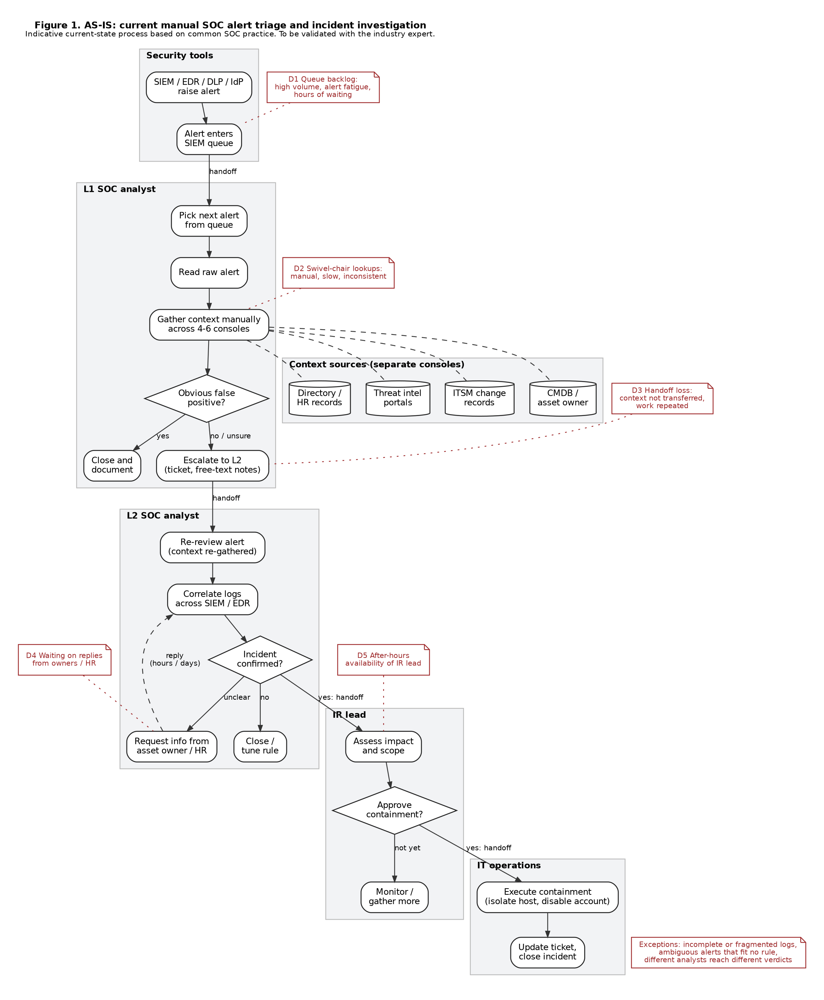
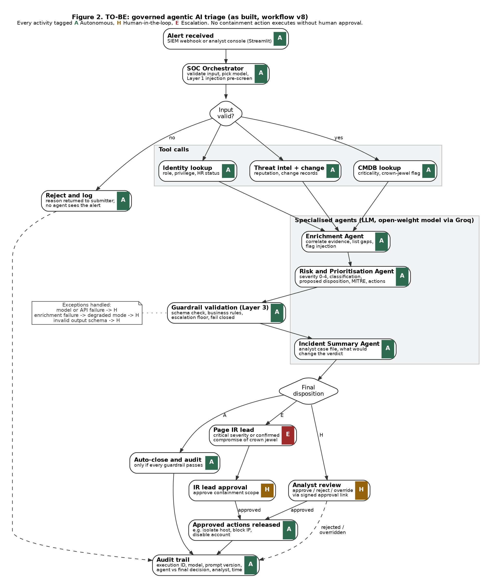
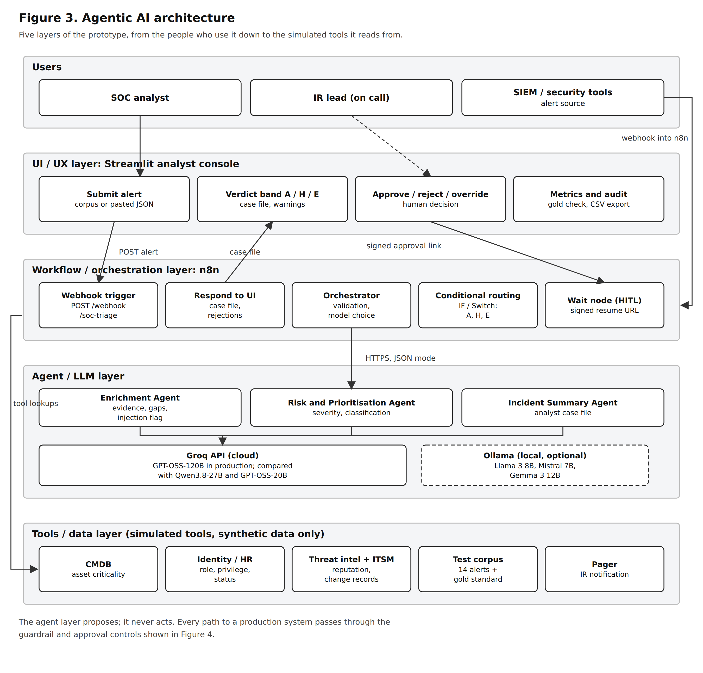
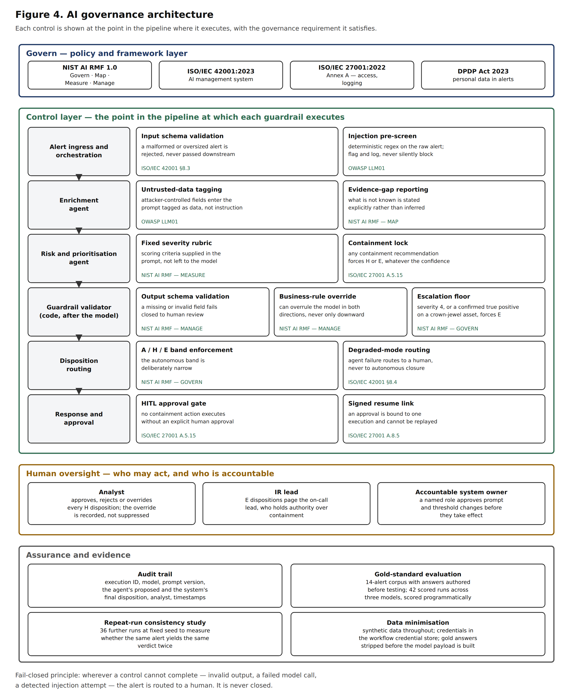

# Governed Agentic AI for SOC Alert Triage

A working prototype that automates the *investigation* of security alerts while deliberately
withholding the *decision*. Three specialised AI agents enrich, assess and summarise an alert in
about five seconds. What happens next is decided by guardrail code that runs **after** the model
and can overrule it.

Built for the Agentic AI Digital Transformation Hackathon — Cybersecurity Challenge.
MBA (ITBM), Symbiosis Centre for Information Technology, Pune.

**Live project site:** https://governed-agentic-soc-triage.netlify.app

---

## The problem

A SOC analyst judging a single alert opens four to six separate consoles — asset register,
identity directory, threat intelligence, change management — assembles the context by hand, and
applies judgement against no documented rubric. When the alert escalates, none of that assembled
context travels with it, so the next analyst starts again.

Triage is therefore not an information-shortage problem. It is an information-assembly and
judgement-consistency problem, which is the shape of problem agentic AI is actually suited to.



---

## The design decision this project is about

Automating investigation is easy. Automating the decision is where it gets dangerous, because the
cost of error is asymmetric: closing a true positive lets an intrusion continue, while containing
a false positive takes down a production host you had no reason to touch.

So every alert is routed to one of three dispositions, and the band is chosen by **code, not by the
model**:

| | | |
|---|---|---|
| **A** | Autonomous | The agents close the alert and log why. Permitted only at severity 0–1, with a classified verdict, no crown-jewel asset, and no action to take. |
| **H** | Human-in-the-loop | The agents recommend; an analyst approves, rejects or overrides. Forced whenever evidence is incomplete, model output is invalid, or an action is proposed. |
| **E** | Escalation | The incident response lead is paged. Forced at severity 4, or on confirmed compromise of a crown-jewel asset — whatever the model proposed. |

No agent in this system holds a credential or a tool that can change the state of any production
system. They produce text. Every path to an action passes through the validator or a human.



---

## Architecture



Five layers: the people who use it, the Streamlit analyst console, the n8n orchestration layer,
the agent layer, and the simulated tool/data layer.

The governance view shows the same pipeline with each control at the point where it actually
executes:



---

## What's in here

```
workflow/    soc_triage_full_chain_v8.json   the complete 26-node n8n workflow
console/     soc_triage_app.py               the Streamlit analyst console (357 lines)
data/        soc_alert_corpus.json           14 synthetic alerts + gold-standard answers
evaluation/  soc_model_comparison_full.json  harness: 14 alerts x 3 models, scored automatically
             soc_variance_run.json           repeat-run consistency harness
             audit_log_sample.csv            exported audit trail from an end-to-end session
prompts/     agent_prompt_suite.md           full system prompts and output schemas
docs/                                        architecture and process diagrams
```

**Where the actual logic lives.** The workflow is not a no-code diagram — 14 of its 26 nodes are
Code nodes containing about 1,131 lines of JavaScript. The ones worth reading:

- `Orchestrator` — input validation and the deterministic prompt-injection pre-screen
- `Validate Risk + Build Summary Request` — **the guardrail validator**, the node the whole
  safety argument rests on
- `Assemble Case File` — builds the analyst-facing case file
- `CMDB Lookup`, `Identity Lookup`, `Threat Intel Lookup` — the simulated context sources
- `Record Human Decision + Audit` — records the agent's proposal and the system's final
  disposition separately, so guardrail interventions stay visible after the fact

To read them: import the JSON into any n8n instance, or open the file and search for `jsCode`.

---

## The guardrails

**Prompt injection, three layers.** Alert telemetry is partly attacker-controlled — user-agent
strings, filenames, process arguments. A triage agent that treats alert content as instruction
rather than evidence is exploitable by design.

1. A regex pre-screen in the orchestrator, before any model runs. Kept as code deliberately: a
   screening step implemented as a model call is vulnerable to the same manipulation it exists to
   detect.
2. Alert and enrichment content wrapped in untrusted-data tags, with every agent prompt stating
   that tagged content is evidence to describe, never instruction to follow — and that an injection
   attempt is itself a security finding to report, not suppress.
3. The validator refuses autonomous closure of any injection-flagged alert, whatever the model said.

Layer 3 is the one that doesn't depend on model behaviour, so it's the one that holds when the
first two fail.

**Fail-closed output validation.** Severity must be an integer 0–4, classification exactly one of
three labels, disposition exactly one of three codes. Any deviation — parse failure, missing field,
invalid value, API error — routes to human review with the raw output retained. The absence of a
valid answer is never read as permission to close.

This was not theoretical. One of the three models tested returned structurally invalid output on
the same alert across three consecutive runs. Every instance routed safely.

**Escalation floor.** Severity 4, or a confirmed true positive on a crown-jewel asset, forces
escalation regardless of the model's proposal — and an escalation the model assigns is never
downgraded. Declarable weakness: this control was added *after* observing that both GPT-OSS models
under-escalated critical alerts, so its performance on this corpus is partly fitted. Validation on
an unseen alert set is outstanding.

---

## Results

Three open-weight models benchmarked under identical conditions — same prompts, same payloads,
same output schema, temperature 0.1, fixed seed — at the Risk and Prioritisation stage. 14 alerts
x 3 models = 42 scored runs, plus 36 repeat runs for consistency.

**Zero unsafe outcomes across 78 runs.** No alert requiring human attention was ever closed
autonomously — including when models returned invalid output, failed entirely, or were targeted by
embedded prompt injection.

Two findings worth the space:

- **Parameter count did not determine quality.** GPT-OSS-20B matched or exceeded GPT-OSS-120B on
  disposition accuracy at roughly 40% lower cost. On 14 alerts those differences aren't
  statistically separable, and they're reported as directional only.
- **Consistency separated the models, and single-pass accuracy couldn't see it.** GPT-OSS-120B
  returned identical dispositions, severities and classifications on every repeat run.
  GPT-OSS-20B varied on both severity and classification and invented two entities. For a system
  that has to be auditable, that matters more than a marginally better score — so GPT-OSS-120B was
  adopted on consistency grounds, not accuracy.

A third finding with wider implications: **chaining agents introduces variance that a single agent
doesn't have.** The Risk agent alone was deterministic at fixed seed; the full chain was not,
because small variations in enrichment output propagate downstream. The mitigation — routing on
severity bands and retrieved asset attributes rather than on generated text — is generalisable to
any multi-agent system.

End-to-end: ~4.9 seconds of agent processing, roughly USD 0.0017 per alert for the full chain.
Human decision latency in the recorded session was 27, 27 and 72 seconds.

---

## Running it

```bash
pip install -r requirements.txt
streamlit run console/soc_triage_app.py
```

`soc_alert_corpus.json` must sit beside the console script, or in the path the app expects.

The console needs an n8n instance running the workflow. Import `workflow/soc_triage_full_chain_v8.json`,
set a Header Auth credential on the three agent nodes pointing at your inference provider, and set
the webhook's own Header Auth credential. Then point the console's sidebar at your webhook address
and enter the matching key.

The deployed instance is self-hosted n8n on a managed container platform with a PostgreSQL backing
store. Its submission endpoint requires a pre-shared header credential — requests without it are
rejected before any agent runs — and the editor requires sign-in.

---

## What this does not establish

Stated plainly, because a prototype that oversells itself is worse than one that doesn't:

- **The corpus is synthetic.** All 14 alerts were authored for this project. Real telemetry is
  noisier, less consistent and incomplete in ways synthetic data doesn't reproduce.
- **The sample is small.** One alert moves any percentage by 7.1 points.
- **The gold standard was authored by the same team** that wrote the prompts and rules measured
  against it. That inflates apparent performance. Notably, all three models disagreed with one gold
  label, which suggests at least one answer is contestable.
- **The escalation floor was fitted** to observed results, as described above.
- **Tool integrations are simulated.** Production integrations bring latency, incompleteness and
  access constraints this prototype never exercises.
- **Analyst identity is self-declared**, not federated to a directory, so the audit trail records a
  claimed identity rather than an authenticated one.
- **Local models** (Llama 3, Mistral, Gemma) were installed and verified but not benchmarked
  against the full corpus, so on-premise deployment is architecturally supported rather than
  empirically evidenced.

---

## Data notice

All data is synthetic. Network addresses use ranges reserved for documentation (RFC 5737 and
RFC 1918). Every organisation, hostname and personal name is fictional. No file in this repository
contains an API credential or any production data.
